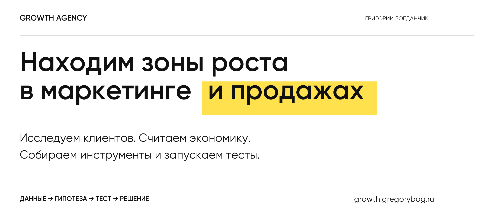
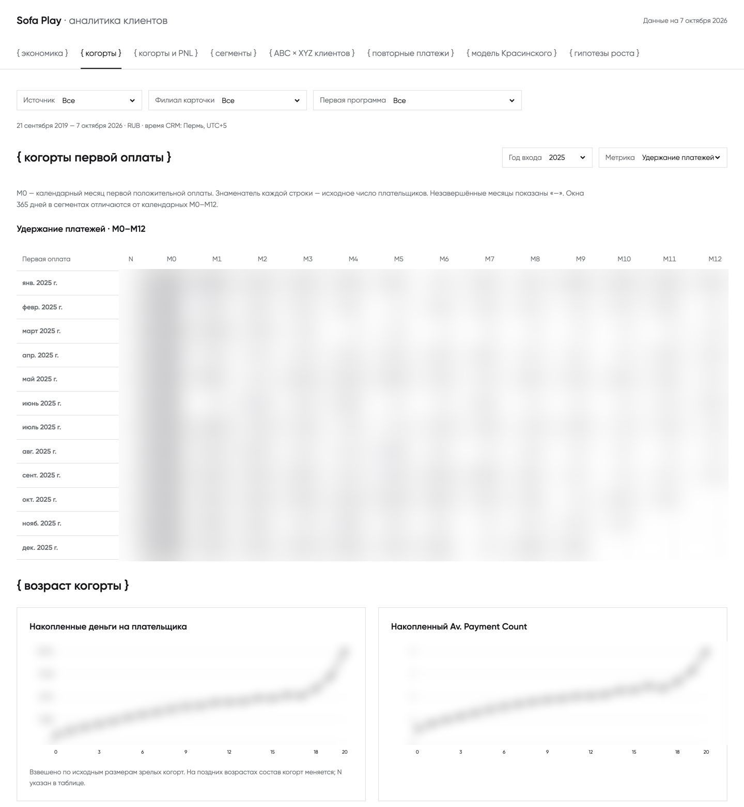
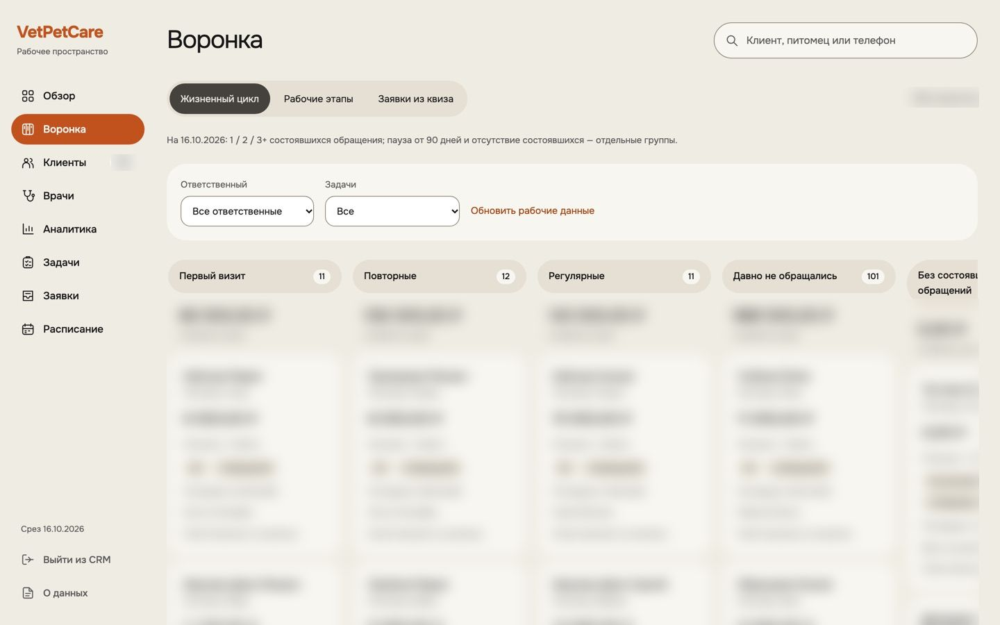
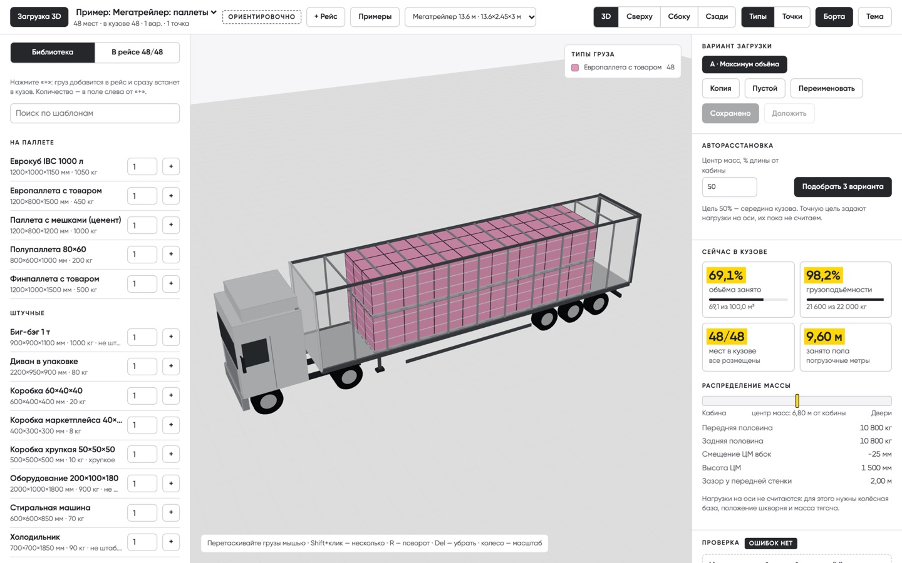
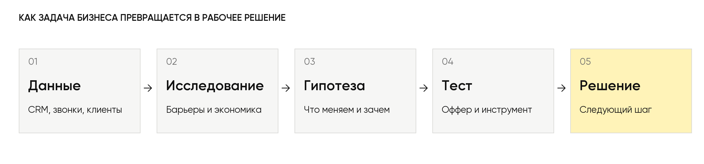

Помогаю собственникам и командам находить зоны роста в маркетинге и продажах. Интегрирую системы, анализирую данные, исследую клиентов и собираю рабочие продукты: CRM, Telegram-ботов, дашборды, сайты и учебные платформы. AI ускоряет путь от задачи бизнеса до решения.

[Сайт и форматы работы](https://growth.gregorybog.ru/) · [Кейсы и отзывы](https://shared.gregorybog.ru/pages/cases-and-reviews/) · [Обсудить задачу](https://t.me/b_greg)

## Избранные работы

### Интеграции и аналитика данных — Sofa Play и VetPetCare

Подключаю CRM и учётные системы, собираю данные и превращаю их в дашборды для собственника и команды.

**Sofa Play:** интеграция с «Мой Класс», анализ платежей, клиентских когорт, повторных обращений и ABC/XYZ-сегментов. Отдельно — обновлённый сайт с направлениями, ценами и подбором занятия.

**VetPetCare:** аналитика клиентской базы и приёмов, собственная CRM, сайт с квизом и сценарием записи на консультацию.

**Результат:** рабочие инструменты для разбора клиентской базы, воронки и поиска точек роста.

[Посмотреть экраны сайтов, CRM и аналитики →](https://shared.gregorybog.ru/pages/cases-and-reviews/#work)

### VetPetCare — собственная CRM ветеринарного центра

Разработал CRM на Ruby on Rails: заявки из квиза, карточки клиентов и питомцев, расписание врачей, онлайн-запись, статусы приёмов, учёт оплат и аналитика. Подключены Telegram-уведомления и импорт истории из YClients.

**Что собрано:** единое рабочее пространство для команды — от входящей заявки до записи, приёма и повторного обращения.

### Корпоративная логистика — планирование загрузки транспорта

Разработал 3D-конструктор загрузки: размещение груза в кузове, расчёт заполнения объёма, грузоподъёмности, погрузочных метров и центра масс.

**Результат:** корпоративное рабочее решение, которым пользуются крупные логистические компании.

### Собственный VPN — сервис с Telegram-ботом

Создал VPN-проект и Telegram-бота для оформления доступа: тарифы, оплата через ЮKassa, статус подписки и управление автоплатежами. В системе — учёт пользователей, платежей и уведомлений.

**Что собрано:** сервис подписки и платёжный контур в Telegram.

### AI-дизайн интерьеров — Telegram-бот

Фото комнаты → выбор задачи и стиля → генерация нового интерьера → PDF-концепция. Добавлены пакеты генераций, оплата, обратная связь и административная аналитика.

**Что собрано:** рабочий Telegram MVP с генерацией дизайна и платёжным сценарием.

### IZI PANEL — Telegram-бот визуализации и расчёта

Клиент присылает фото помещения или планировки, выбирает материал и фактуру. Бот помогает увидеть панели в интерьере и получить предварительный расчёт.

**Результат:** связка от выбора материала к визуализации и запросу расчёта.

[Сайт IZI PANEL →](https://izipanel.ru/)

### VetPetCare — Telegram-бот первичного обращения

Бот уточняет запрос клиента, помогает выбрать маршрут обращения и передаёт контакт сотруднику. Подключена база знаний клиники; предусмотрен переход к человеку.

**Что собрано:** сценарий первичного общения и передачи обращения в работу команды.

### MaterLux — бот подбора матрасов

Telegram-помощник для менеджеров: подбор по параметрам клиента, сравнение моделей и аналогов, карточки с характеристиками и готовый текст для ответа покупателю.

**Что собрано:** инструмент подбора с историей запросов, оценками рекомендаций и аналитикой использования.

### MaterLux — корпоративное AI-обучение

Провожу практическое обучение команды на задачах её отделов. Участники создают свои инструменты: разбор звонков по чек-листу, медиаплан, мониторинг конкурентов и управленческие отчёты.

**Результат обучения:** проекты и прототипы участников, встроенные в контекст их работы.

[Работы и отзывы участников →](https://shared.gregorybog.ru/pages/cases-and-reviews/#training)

### Собственная LMS-платформа

Создал собственную платформу для проведения обучения. На ней веду корпоративную программу MaterLux: уроки, записи, конспекты, материалы, тесты и практические задания собраны в одном месте.

**Результат:** рабочая учебная среда для корпоративной программы.

### «Навстречу» — директор по развитию

Работаю директором по развитию проекта. Соединяю продукт, маркетинг, продажи и рабочие инструменты команды: исследования аудитории, офферы, посадочные страницы, воронку и аналитику.

Среди созданных инструментов — командный центр с задачами, показателями, документами и отдельными рабочими экранами по ролям, а также обучение наставников.

**Моя роль:** развитие проекта и доведение решений до работы команды.

### «Навстречу» — сайт и посадочная страница

Создал сайт проекта для подростков и родителей и посадочную страницу семейного чек-апа: оффер, структура программы, ответы на вопросы и путь к заявке.

**Что собрано:** веб-страницы, которые знакомят семью с проектом и помогают перейти к первому обращению.

[Сайт «Навстречу» →](https://navstrechu-family.ru/)

### SoftFin — финансовый сайт Елены Винокуровой

Разработал сайт финансового консалтинга: упаковка экспертизы и услуг, визуальная концепция «Стекло», интерактивная диагностика и форма обращения. Для передачи заявок подключён Telegram-бот.

**Что собрано:** сайт с квизом и связкой «ответы клиента → заявка → уведомление в Telegram».

### РосКод — сайт услуг по штрих-кодам

Спроектировал структуру сайта, сценарии выбора и интерактивные квизы расчёта. Собрал несколько дизайн-версий для сравнения и выбора направления.

**Что собрано:** опубликованные интерактивные прототипы сайта; формы в представленных версиях демонстрационные.

[Посмотреть версии сайта РосКод →](https://shared.gregorybog.ru/pages/roskod-versions/)

## Как строю работу

У каждой проверки — метрика, исходное значение и правило решения. После теста определяем, что масштабировать, доработать или остановить.

## Что остаётся у команды

Исследования клиентов, карта пути, расчёты экономики, материалы тестов и рабочие инструменты. Контекст и решения сохраняются так, чтобы команда могла продолжать работу.

## Стек и инструменты

**Продукты и сервисы**

     

**AI и интеграции**

    

REST API · Turbo · Stimulus

**Данные и исследования:** CRM-аналитика · CJM / JTBD · юнит-экономика · дашборды и проверка гипотез.

## Давай разберём твою задачу

Начнём с текущей воронки, цели бизнеса и ограничения. Выберем следующий шаг и подходящий формат работы.

**[Написать в Telegram →](https://t.me/b_greg)** · [Посмотреть отзывы клиентов](https://shared.gregorybog.ru/pages/cases-and-reviews/#reviews)
