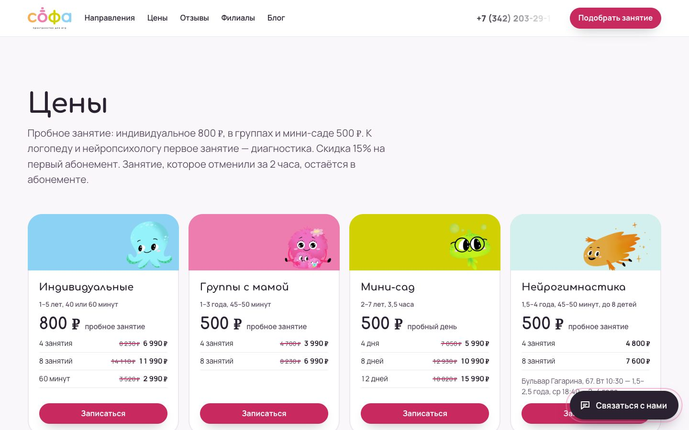

Помогаю собственникам и командам разобраться, где теряются спрос, продажи и время. Исследую клиентов, собираю воронку и экономику, превращаю гипотезы в страницы, аналитику и рабочие инструменты. AI ускоряет анализ и производство внутри этой работы.

[Сайт и форматы работы](https://growth.gregorybog.ru/) · [Кейсы и отзывы](https://shared.gregorybog.ru/pages/cases-and-reviews/) · [Обсудить задачу](https://t.me/b_greg)

## Избранные работы

### VetPetCare — помочь выбрать специалиста

Для онлайн-клиники поведенческой медицины собран сайт с квизом «Не знаю, какой врач нужен» и записью на консультацию.

**Что создано: сайт, подбор специалиста и сценарий записи.**

[Посмотреть работу и экраны](https://shared.gregorybog.ru/pages/cases-and-reviews/#work)

### Софа — сделать выбор занятия понятнее

Для детского центра пересобрана структура сайта: направления, цены и подбор занятия. Отдельно собрана аналитика клиентов по истории CRM.

**Что создано: сайт и дашборд для разбора клиентской базы.**

[Посмотреть работу и экраны](https://shared.gregorybog.ru/pages/cases-and-reviews/#work)

### MaterLux — перенести AI в задачи отделов

Практическое обучение на материалах команды. В работах участников — разбор звонков по чек-листу, медиаплан, мониторинг конкурентов и управленческие отчёты.

**Результат обучения: проекты и прототипы участников.**

[Посмотреть работу и экраны](https://shared.gregorybog.ru/pages/cases-and-reviews/#training)

### Логистика — показать план загрузки машины

После разбора процесса логистов собран MVP 3D-конструктора: раскладка груза, заполнение объёма, грузоподъёмность и центр масс.

**Что создано: MVP сервиса планирования загрузки.**

[Посмотреть работу и экраны](https://shared.gregorybog.ru/pages/cases-and-reviews/#work)

## Как строю работу

У каждой проверки — метрика, исходное значение и правило решения. После теста определяем, что масштабировать, доработать или остановить.

## Что остаётся у команды

Исследования клиентов, карта пути, расчёты экономики, материалы тестов и рабочие инструменты. Контекст и решения сохраняются так, чтобы команда могла продолжать работу.

## Стек и инструменты

**Продукты и сервисы:** Ruby on Rails · Hotwire (Turbo, Stimulus) · PostgreSQL · HTML / CSS / JavaScript.

**AI и интеграции:** Codex · Claude Code · MCP · REST API · Telegram Bot API · Bitrix24.

**Данные и исследования:** CRM-аналитика · CJM / JTBD · юнит-экономика · дашборды и проверка гипотез.

## Давай разберём твою задачу

Начнём с текущей воронки, цели бизнеса и ограничения. Выберем следующий шаг и подходящий формат работы.

**[Написать в Telegram →](https://t.me/b_greg)** · [Посмотреть отзывы клиентов](https://shared.gregorybog.ru/pages/cases-and-reviews/#reviews)
