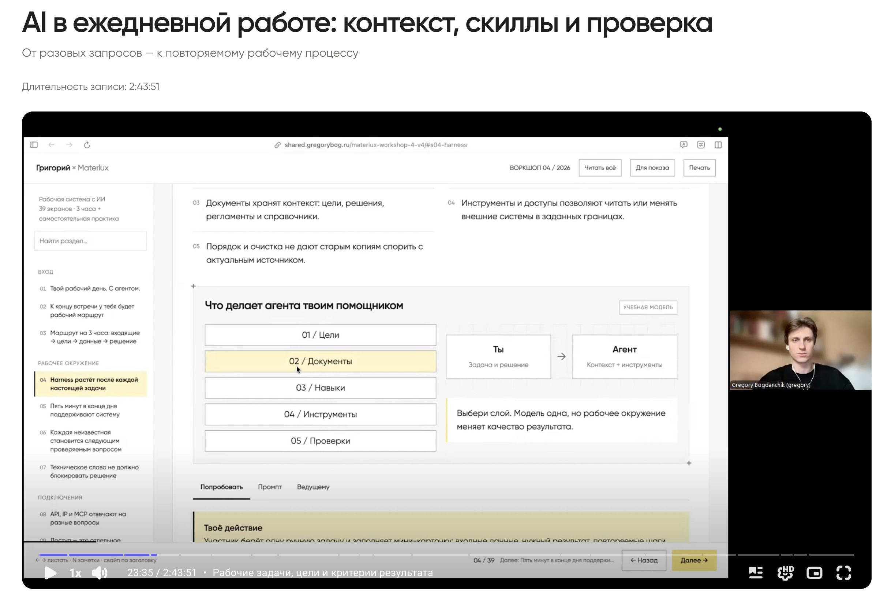
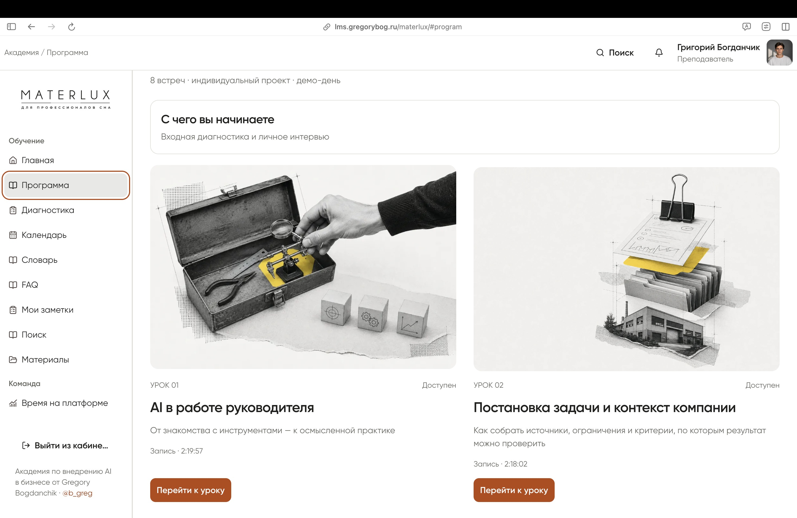
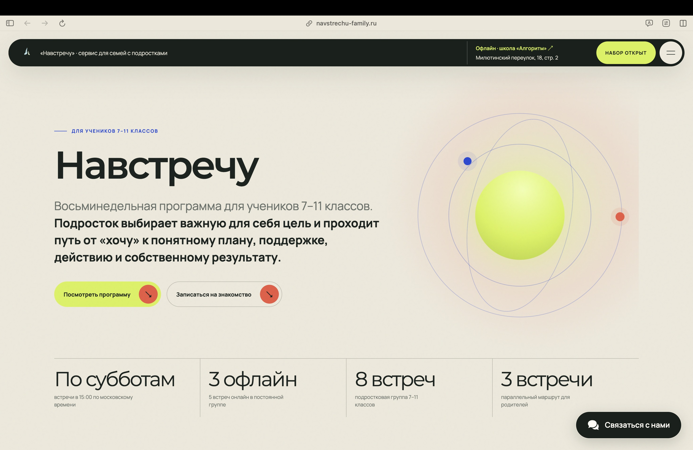
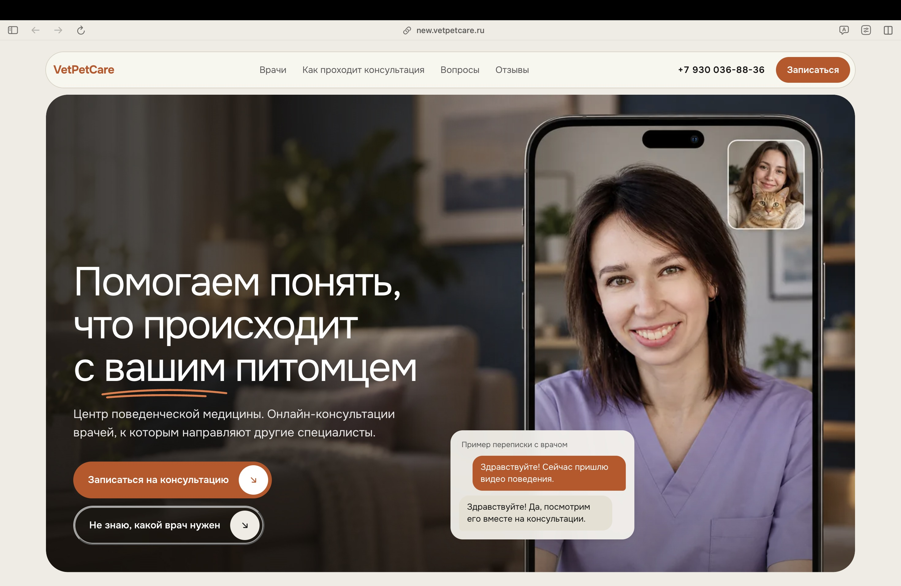
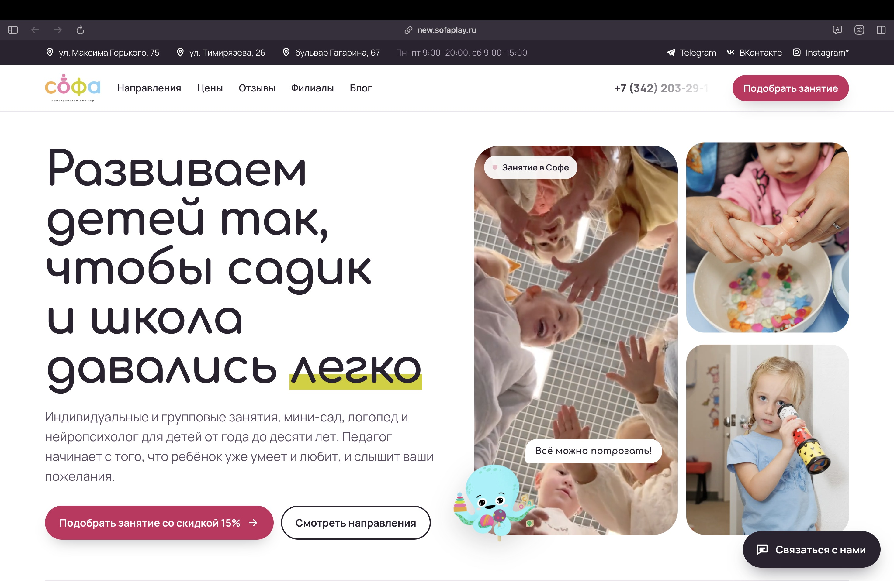

# Григорий Богданчик — AI, боты, сайты и системы для бизнеса

**Григорий Богданчик (Gregory Bogdanchik), Growth Agency.** Внедряю AI в бизнес, обучаю команды и разрабатываю Telegram-ботов, сайты, CRM и внутренние системы. Основной фокус — средний бизнес и команды 30–50 человек.

[Обсудить проект](https://t.me/b_greg) · [Услуги и подход](https://growth.gregorybog.ru/) · [Кейсы и отзывы](https://shared.gregorybog.ru/pages/cases-and-reviews/)

## Что можно заказать

- **Разработка Telegram-ботов:** AI-помощники, подбор товаров, заявки, генерация изображений, платежи и подписки.
- **Разработка сайтов и лендингов:** оффер, дизайн, квизы, формы и передача заявок в Telegram или CRM.
- **CRM и корпоративные системы:** расписание, клиентская база, личные кабинеты, LMS и инструменты сотрудников.
- **Интеграции и аналитика данных:** API, CRM, дашборды, клиентские когорты и сегменты.
- **Внедрение AI и обучение команд:** аудит процесса, AI-агенты, практическое обучение и пилот на задачах компании.

## Внедрение AI, обучение и корпоративные системы

<table>
<tr>
<td width="50%" valign="top">
<h3>MaterLux · корпоративное обучение AI</h3>

Обучение сотрудников работе с AI на задачах отделов: звонки, отчёты, маркетинг. Результат — проекты и прототипы участников.

<a href="https://shared.gregorybog.ru/pages/cases-and-reviews/#training">Работы и отзывы →</a>

</td>
<td width="50%" valign="top">
<h3>LMS · платформа корпоративного обучения</h3>

Разработал LMS для корпоративного обучения: уроки, записи, тесты и задания. На платформе веду программу MaterLux.

<a href="assets/screens/materlux-program.jpg">Открыть экран →</a>

</td>
</tr>
<tr>
<td width="50%" valign="top">
<h3>Sofa Play и VetPetCare · аналитика CRM</h3>

Интеграции с CRM, когорты, повторные обращения и сегменты клиентов. Дашборды для поиска точек роста.

<a href="https://shared.gregorybog.ru/pages/cases-and-reviews/#work">Посмотреть работы →</a>

</td>
<td width="50%" valign="top">
<h3>VetPetCare · разработка CRM на Rails</h3>

CRM на Ruby on Rails: клиенты и питомцы, расписание, онлайн-запись и оплаты. Интеграция квиза с рабочим пространством клиники.

<a href="assets/portfolio/crm.jpg">Открыть экран →</a>

</td>
</tr>
<tr>
<td width="50%" valign="top">
<h3>Логистика · корпоративный 3D-сервис</h3>

3D-планирование загрузки транспорта. Рабочее решение используется крупными логистическими компаниями.

<a href="assets/portfolio/logistics.jpg">Открыть экран →</a>

</td>
<td width="50%" valign="top">
<h3>«Навстречу» · развитие проекта</h3>

Директор по развитию. Продукт, маркетинг и командный центр: задачи, показатели, воронка и документы.

<a href="assets/portfolio/nav-team.jpg">Открыть экран →</a>

</td>
</tr>
</table>

## Разработка Telegram-ботов для бизнеса

<table>
<tr>
<td width="50%" valign="top">
<h3>MaterLux · Telegram-бот подбора</h3>

Telegram-бот для менеджеров: параметры клиента → модели и аналоги → ответ покупателю. История и аналитика подборов.

<a href="assets/portfolio/mattress.jpg">Открыть экран →</a>

</td>
<td width="50%" valign="top">
<h3>VetPetCare · AI-бот для клиентов</h3>

AI-бот отвечает по базе знаний клиники, уточняет запрос и передаёт обращение сотруднику.

<a href="https://t.me/vetpetcare_bot">Открыть бота →</a>

</td>
</tr>
<tr>
<td width="50%" valign="top">
<h3>IZI PANEL · бот визуализации</h3>

Telegram-бот: фото помещения → выбор фактуры → AI-визуализация панелей и предварительный расчёт.

<a href="https://t.me/Izi_panel_bot">Открыть бота →</a>

</td>
<td width="50%" valign="top">
<h3>AI Remont · бот дизайна интерьеров</h3>

Telegram-бот генерации интерьера: фото комнаты → AI-концепция → PDF. MVP с оплатой пакетов генераций.

<a href="https://t.me/malina_homedesign_bot">Открыть бота →</a>

</td>
</tr>
</table>

## Разработка сайтов, лендингов и сервисов

<table>
<tr>
<td width="50%" valign="top">
<h3>Forest VPN · бот с подпиской и оплатой</h3>

VPN-подписка в Telegram: тарифы, оплата, статус доступа и управление автоплатежами.

<a href="https://t.me/forest1vpn_bot">Открыть сервис →</a>

</td>
<td width="50%" valign="top">
<h3>«Навстречу» · разработка лендинга</h3>

Программа для подростков и родителей, семейный чек-ап и путь к первому обращению.

<a href="https://navstrechu-family.ru/">Открыть сайт →</a> · <a href="assets/screens/navstrechu-signals.jpg">Ещё экран</a>

</td>
</tr>
<tr>
<td width="50%" valign="top">
<h3>SoftFin · сайт финансового консалтинга</h3>

Сайт финансового консалтинга Елены Винокуровой: услуги, квиз-диагностика и форма с передачей заявок в Telegram.

<a href="assets/portfolio/softfin.jpg">Открыть экран →</a>

</td>
<td width="50%" valign="top">
<h3>РосКод · прототип сайта услуг</h3>

Структура предложения, квизы и дизайн-версии сайта по штрих-кодам. Формы в прототипах демонстрационные.

<a href="https://shared.gregorybog.ru/pages/roskod-versions/">Посмотреть версии →</a>

</td>
</tr>
<tr>
<td width="50%" valign="top">
<h3>VetPetCare · сайт ветеринарного центра</h3>

Специалисты, направления и квиз подбора врача. Понятный путь от запроса до записи на консультацию.

<a href="https://new.vetpetcare.ru/">Открыть сайт →</a> · <a href="assets/screens/vetpetcare-specialists.jpg">Ещё экран</a>

</td>
<td width="50%" valign="top">
<h3>Sofa Play · сайт детского центра</h3>

Направления, возрастные программы и подбор занятия. Структура сайта помогает родителю выбрать подходящий формат.

<a href="https://new.sofaplay.ru/">Открыть сайт →</a> · <a href="assets/screens/sofaplay-programs.jpg">Ещё экран</a>

</td>
</tr>
</table>

## Как проходит работа

**Задача бизнеса → пилот → разработка или обучение → интеграция → проверка результата.** Компания получает инструменты, инструкции и владельцев процессов.

## Вопросы о разработке и внедрении AI

<b>Можно заказать только Telegram-бота или сайт?</b>

Да. Разрабатываю отдельные боты, сайты и лендинги, а также связанные решения: форма → заявка → Telegram или CRM. Примеры — VetPetCare, IZI PANEL и SoftFin.

<b>Какие корпоративные системы ты разрабатываешь?</b>

CRM, LMS, внутренние кабинеты, дашборды и специализированные сервисы. Среди работ — CRM VetPetCare, платформа обучения MaterLux и 3D-планирование загрузки транспорта.

<b>Как внедрить AI в работу команды?</b>

Начинаем с процесса и критерия качества. Собираем пилот на задачах компании, обучаем сотрудников, подключаем данные и инструменты, закрепляем владельца. Пример практического обучения — MaterLux.

<b>С чем можно связать бота или внутреннюю систему?</b>

С CRM, сайтом, Telegram и другими сервисами через API. В кейсах есть работа с Bitrix24, «Мой Класс», историей YClients и платёжными сценариями ЮKassa. Состав конкретной интеграции проверяем до разработки.

## Стек и инструменты

**Продукты и сервисы**

     

**AI и интеграции**

    

REST API · Turbo · Stimulus

**Данные и исследования:** CRM-аналитика · CJM / JTBD · юнит-экономика · дашборды и проверка гипотез.

## Заказать разработку или обсудить внедрение AI

Расскажи задачу: бот, сайт, CRM, аналитика или обучение команды. Определим первый шаг и объём работы.

**[Написать в Telegram →](https://t.me/b_greg)**
