<a href="https://growth.gregorybog.ru/">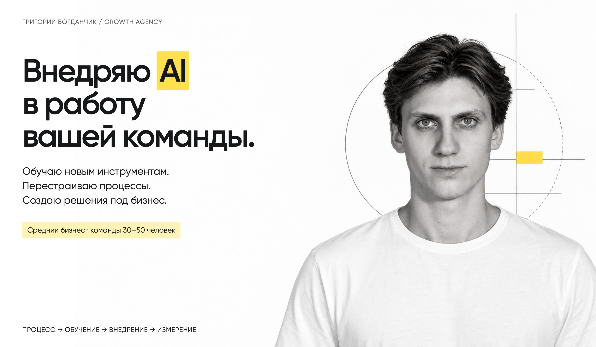</a>

**Внедряю AI в средний бизнес и команды 30–50 человек.** Обучаю сотрудников, автоматизирую процессы и создаю решения под задачи компании.

[Обсудить внедрение](https://t.me/b_greg) · [Сайт](https://growth.gregorybog.ru/) · [Кейсы и отзывы](https://shared.gregorybog.ru/pages/cases-and-reviews/)

## Обучение, данные и процессы

<table>
<tr>
<td width="50%" valign="top">
<h3>MaterLux · AI-обучение</h3>
<a href="assets/portfolio/training.jpg">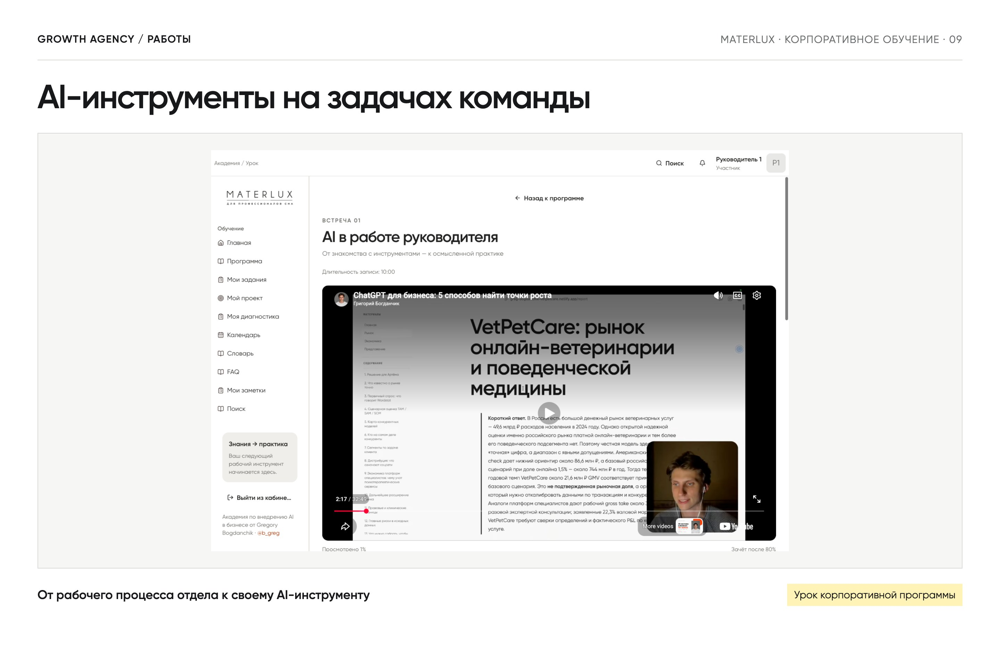</a>

Практика на задачах отделов: звонки, отчёты, маркетинг. На выходе — проекты и прототипы участников.

<a href="https://shared.gregorybog.ru/pages/cases-and-reviews/#training">Работы и отзывы →</a>

</td>
<td width="50%" valign="top">
<h3>Собственная LMS</h3>
<a href="assets/portfolio/lms.jpg">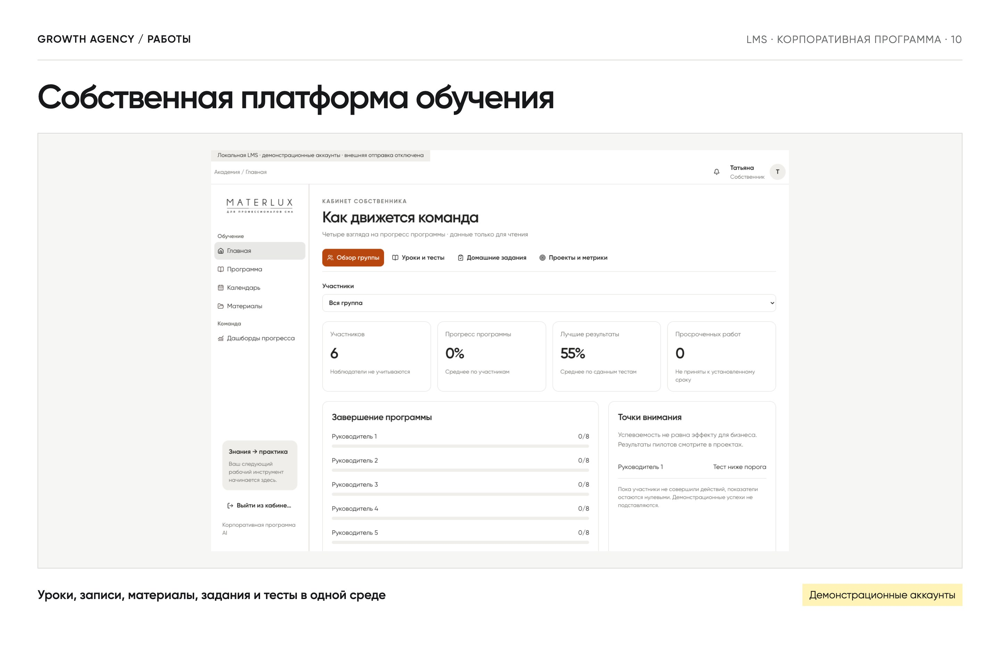</a>

Уроки, записи, тесты и задания в одной платформе. Использую для корпоративной программы MaterLux.

<a href="assets/portfolio/lms.jpg">Открыть экран →</a>

</td>
</tr>
<tr>
<td width="50%" valign="top">
<h3>Sofa Play и VetPetCare · аналитика</h3>
<a href="assets/portfolio/analytics.jpg">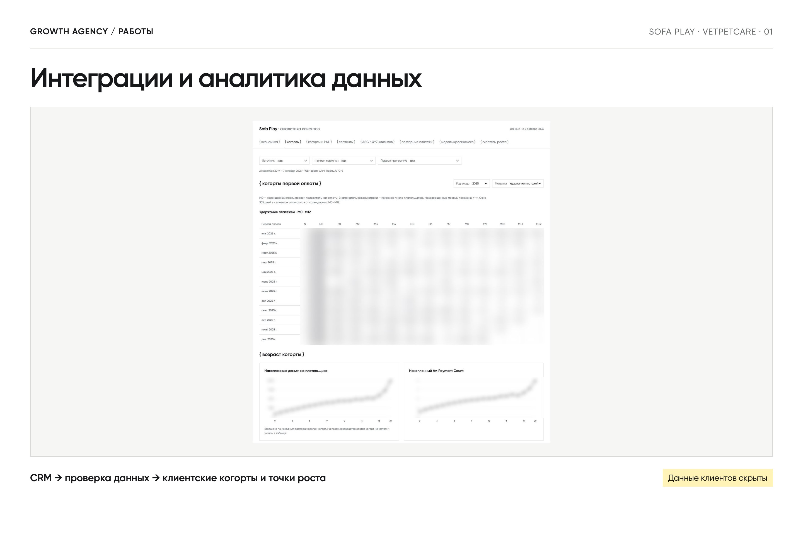</a>

Интеграции с CRM, когорты, повторные обращения и сегменты клиентов. Дашборды для поиска точек роста.

<a href="https://shared.gregorybog.ru/pages/cases-and-reviews/#work">Посмотреть работы →</a>

</td>
<td width="50%" valign="top">
<h3>VetPetCare · CRM на Rails</h3>
<a href="assets/portfolio/crm.jpg">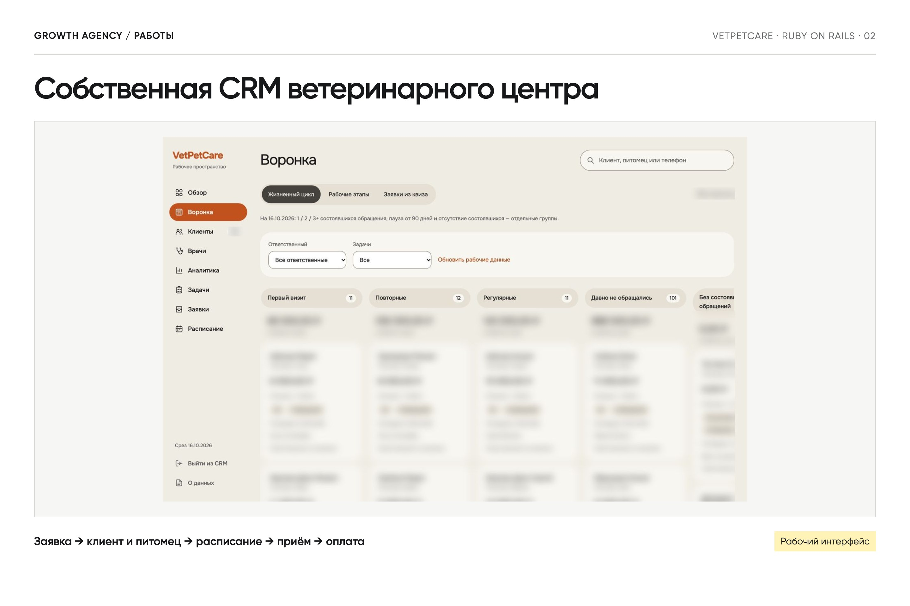</a>

Заявки, клиенты и питомцы, расписание, запись и оплаты. Единое рабочее пространство команды.

<a href="assets/portfolio/crm.jpg">Открыть экран →</a>

</td>
</tr>
<tr>
<td width="50%" valign="top">
<h3>Корпоративная логистика</h3>
<a href="assets/portfolio/logistics.jpg">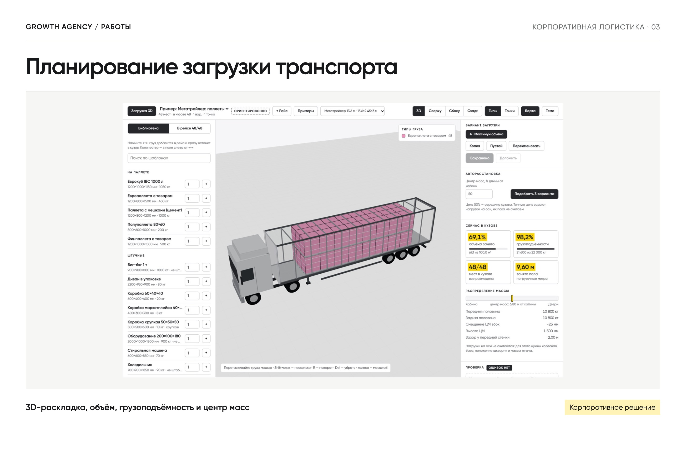</a>

3D-планирование загрузки транспорта. Рабочее решение используется крупными логистическими компаниями.

<a href="assets/portfolio/logistics.jpg">Открыть экран →</a>

</td>
<td width="50%" valign="top">
<h3>«Навстречу» · развитие проекта</h3>
<a href="assets/portfolio/nav-team.jpg">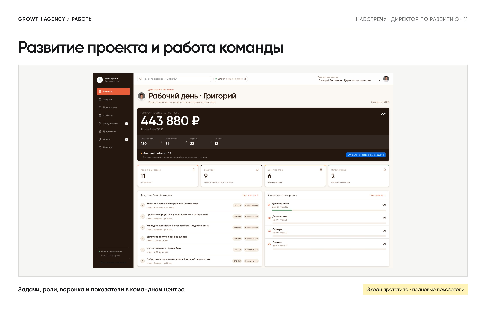</a>

Директор по развитию. Продукт, маркетинг и командный центр: задачи, показатели, воронка и документы.

<a href="assets/portfolio/nav-team.jpg">Открыть экран →</a>

</td>
</tr>
</table>

## Telegram-боты

<table>
<tr>
<td width="50%" valign="top">
<h3>MaterLux · подбор матрасов</h3>
<a href="assets/portfolio/mattress.jpg">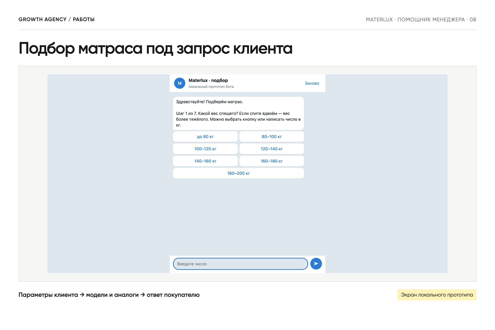</a>

Параметры клиента → подходящие модели и аналоги → готовый ответ покупателю. История и аналитика подборов.

<a href="assets/portfolio/mattress.jpg">Открыть экран →</a>

</td>
<td width="50%" valign="top">
<h3>VetPetCare · помощник клиента</h3>
<a href="assets/portfolio/vpc-bot.jpg">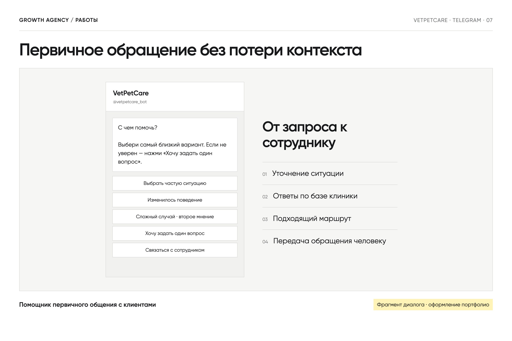</a>

Уточняет запрос, отвечает по базе клиники и передаёт обращение сотруднику.

<a href="https://t.me/vetpetcare_bot">Открыть бота →</a>

</td>
</tr>
<tr>
<td width="50%" valign="top">
<h3>IZI PANEL · визуализация</h3>
<a href="assets/portfolio/izipanel.jpg">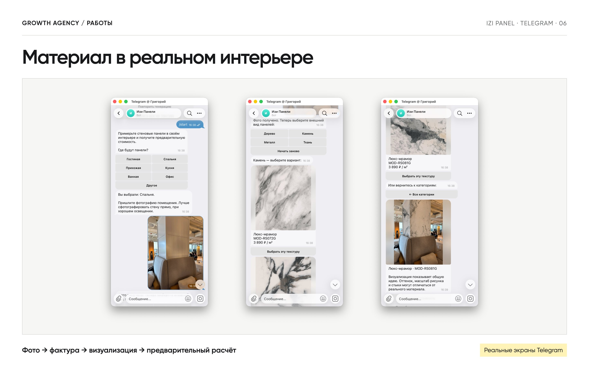</a>

Фото помещения → выбор фактуры → панели в интерьере и предварительный расчёт.

<a href="https://t.me/Izi_panel_bot">Открыть бота →</a>

</td>
<td width="50%" valign="top">
<h3>AI Remont · дизайн интерьеров</h3>
<a href="assets/portfolio/interior.jpg">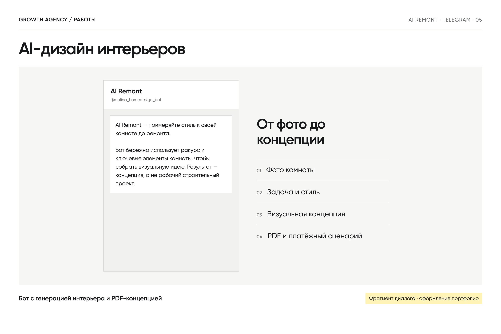</a>

Фото комнаты → новая концепция → PDF. Рабочий MVP с оплатой пакетов генераций.

<a href="https://t.me/malina_homedesign_bot">Открыть бота →</a>

</td>
</tr>
</table>

## Сервисы и сайты

<table>
<tr>
<td width="50%" valign="top">
<h3>Forest VPN · собственный сервис</h3>
<a href="assets/portfolio/vpn.jpg">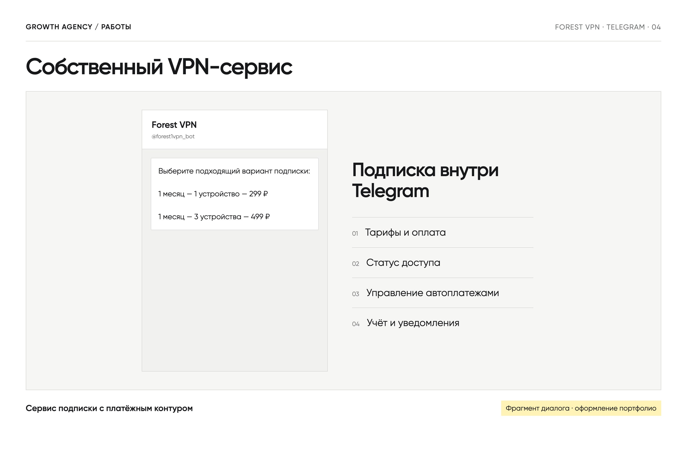</a>

VPN-подписка в Telegram: тарифы, оплата, статус доступа и управление автоплатежами.

<a href="https://t.me/forest1vpn_bot">Открыть сервис →</a>

</td>
<td width="50%" valign="top">
<h3>«Навстречу» · сайт и лендинг</h3>
<a href="assets/portfolio/nav-site.jpg">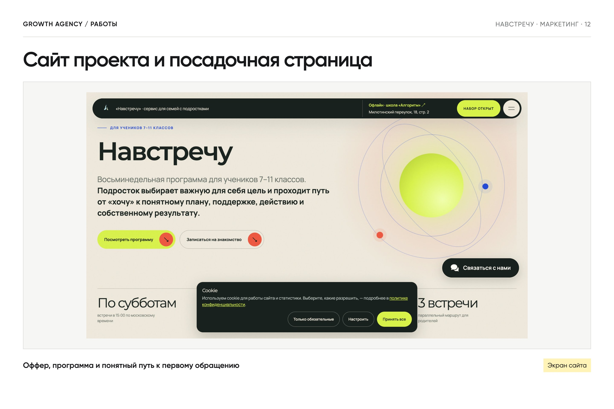</a>

Программа для подростков и родителей, семейный чек-ап и путь к первому обращению.

<a href="https://navstrechu-family.ru/">Открыть сайт →</a>

</td>
</tr>
<tr>
<td width="50%" valign="top">
<h3>SoftFin · финансовый сайт</h3>
<a href="assets/portfolio/softfin.jpg">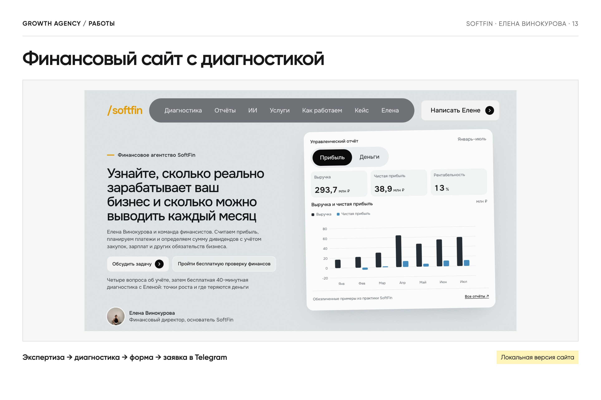</a>

Сайт Елены Винокуровой: услуги, диагностика и форма. Заявки передаются в Telegram.

<a href="assets/portfolio/softfin.jpg">Открыть экран →</a>

</td>
<td width="50%" valign="top">
<h3>РосКод · сайт услуг</h3>
<a href="assets/portfolio/roskod.jpg">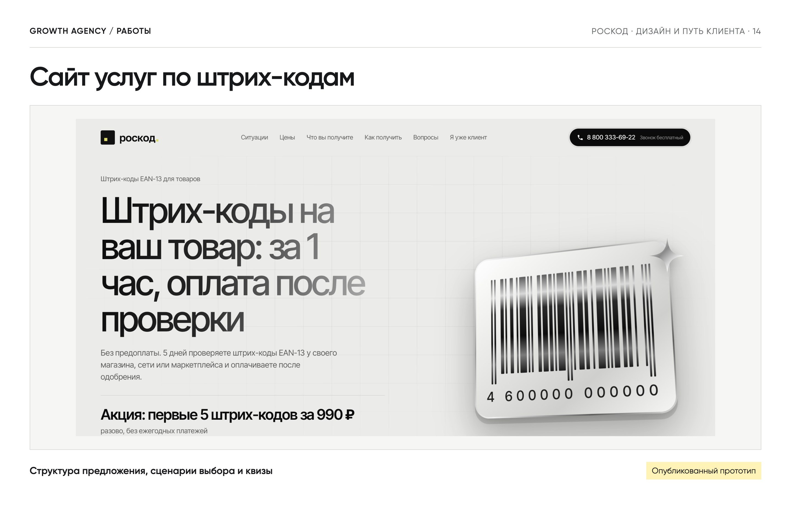</a>

Структура предложения, квизы и дизайн-версии сайта по штрих-кодам. Формы в прототипах демонстрационные.

<a href="https://shared.gregorybog.ru/pages/roskod-versions/">Посмотреть версии →</a>

</td>
</tr>
</table>

## Как работаю

**Процесс → пилот → обучение → интеграция → измерение.** У команды остаются инструменты, инструкции и владельцы процессов.

## Стек и инструменты

**Продукты и сервисы**

     

**AI и интеграции**

    

REST API · Turbo · Stimulus

**Данные и исследования:** CRM-аналитика · CJM / JTBD · юнит-экономика · дашборды и проверка гипотез.

## Обсудим внедрение

Какой отдел хочешь усилить и где команда теряет время?

**[Написать в Telegram →](https://t.me/b_greg)**
